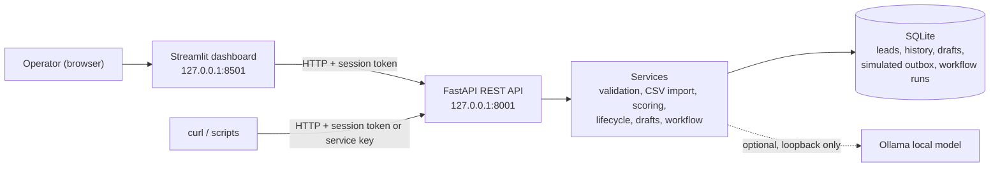
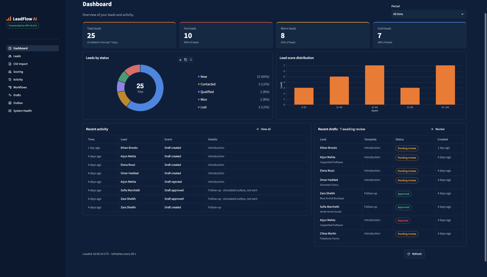
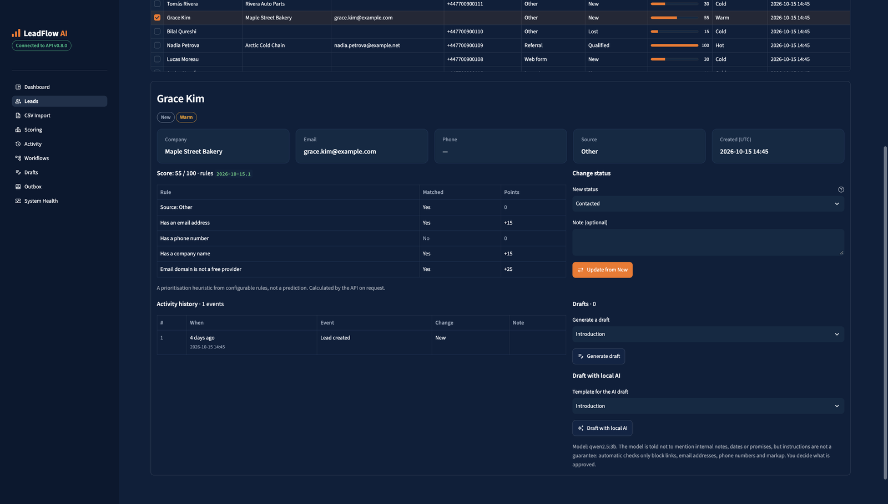
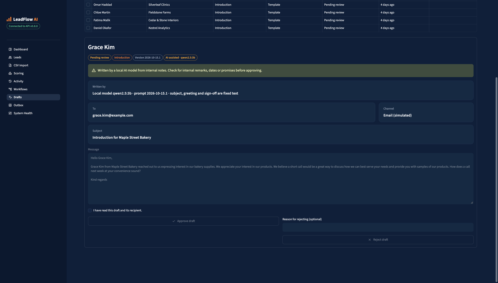
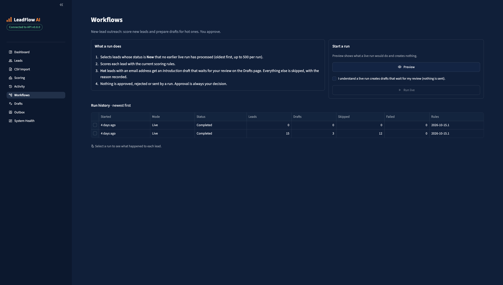
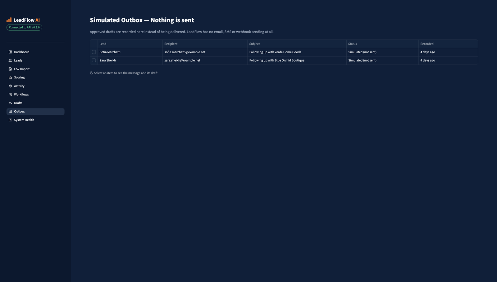

# LeadFlow AI

A local-first lead management system for small sales teams: capture and validate leads, import them from CSV, score and prioritise them, track each lead through its lifecycle, and prepare outreach drafts that a person reviews before anything happens. It comes with a REST API, an operator dashboard and an optional AI assistant that runs entirely on your own machine.

**What this project demonstrates**

- **Workflow automation with a human in the loop.** A versioned outreach workflow prepares drafts automatically, but only a person can approve them, and approval records a *simulated* send. Nothing is ever emailed.
- **Data integrity enforced by the database**, not just the code: Alembic migrations, CHECK constraints, partial unique indexes and triggers that make drafts and the outbox immutable and stop duplicates, even under concurrent requests.
- **Responsible use of AI.** Optional draft writing with a local model (Ollama), restricted to loopback, with prompt-injection-aware prompting, deterministic output checks, permanent provenance and a visible review warning. Its limits are documented, not hidden.
- **Accounts and access control.** Password sign-in (scrypt hashes), 8-hour sessions, admin and viewer roles checked centrally on every API route, a 3-attempt sign-in lockout with a live countdown, and an audit trail recording who made each change.
- **Privacy by design.** No personal data in errors or logs, and everything bound to `127.0.0.1`.
- **Engineering quality.** Strict mypy, Ruff, a large automated test suite with full line and branch coverage of the backend, CI on every push, and an architecture decision record for every milestone.

## Quickstart

Needs Python 3.12 and [uv](https://docs.astral.sh/uv/) (macOS or Linux; the dev script uses `lsof` and `curl`). From a fresh clone:

```sh
git clone https://github.com/hamazmubashar/leadflow-ai.git && cd leadflow-ai
uv sync --group ui
uv run python -c "import pathlib, secrets; t = pathlib.Path('.env.example').read_text(); open('.env', 'x').write(t.replace('LEADFLOW_OPERATOR_TOKEN=', 'LEADFLOW_OPERATOR_TOKEN=' + secrets.token_urlsafe(32), 1))"
uv run alembic upgrade head
uv run python -m leadflow_ai.manage_users create yourname --role admin
bash scripts/dev.sh
```

1. Installs the locked dependencies, including the dashboard.
2. Creates `.env` from `.env.example` with a new random service key (used by scripts, never by the dashboard). It refuses to overwrite an existing `.env`.
3. Creates the local SQLite database (`leadflow.db`).
4. Creates your admin account. The password (at least 12 characters) is typed twice at a hidden prompt.
5. Starts the API on `http://127.0.0.1:8001` and the dashboard on **http://127.0.0.1:8501**, where you sign in. Ctrl+C stops both.

**Demo data (optional):** on the dashboard's **CSV Import** page, upload `demo/demo-leads.csv` (25 fictional leads), then run `uv run --group ui python scripts/seed_demo.py` in a second terminal to give some of them a history and pending drafts. **AI drafts** stay off until you set them up (see [AI-assisted drafts](#ai-assisted-drafts-m9-optional)).

The repository is private; it is shared with clients on request.

## Architecture



- **The API is the only way in.** The dashboard never opens the database; it signs in and uses the same endpoints, with the same role checks, as any client.
- **Pure core, thin edges.** Validation, scoring rules, lifecycle transitions, templates, the workflow decision and the AI output checks are pure Python with no I/O, so they are tested directly.
- **The database guards the rules too.** Migrations add constraints and triggers that refuse invalid states (a second pending draft, an outbox item for an unapproved draft, a false "completed" run), so a bug in one layer can't break them.

## Screenshots

All screenshots use the fictional demo data.

| | |
|---|---|
|  |  |
| **Dashboard:** KPIs, leads by status, score distribution, recent activity | **Lead detail:** score breakdown, status change, history, drafts and the local-AI button |
|  |  |
| **Draft review:** an AI-assisted draft with its provenance and review warning. Here the model invented "bakery supplies" and offered samples, exactly what the reviewer must catch before approving | **Workflows:** preview or run the outreach workflow, with per-lead results |
|  | |
| **Simulated outbox:** approved drafts recorded as *would be sent*; nothing is sent | |

## Milestones

- **M0, foundation:** a FastAPI service with a health endpoint, typed configuration, reusable operator authentication, and quality tooling.
- **M1, lead validation:** pure-Python validation and normalization of lead input.
- **M2, storage and API:** a local SQLite database (SQLAlchemy and Alembic) and an authenticated REST API to create and read leads.
- **M3, CSV import:** upload a CSV file of leads; every row is validated and the whole file is imported, or nothing is.
- **M4, lead scoring:** a 0–100 score with a hot/warm/cold tier, calculated on request from versioned TOML rules, with a per-rule explanation.
- **M5, lead lifecycle:** each lead has a status (new, contacted, qualified, won, lost), changed through allowed transitions, with an append-only activity history.
- **M6, response drafts:** generate an email draft for a lead from a fixed template, have a person approve or reject it, and record approved drafts in a **simulated** outbox.
- **M7, dashboard:** a Streamlit operator dashboard (dark navy and orange) that uses only the REST API: KPIs and charts, leads with details and status changes, CSV import, scoring, activity, draft review and the simulated outbox.
- **M8, workflow runs:** a fixed, versioned "new-lead outreach" workflow that scores new leads and prepares introduction drafts for hot ones, with a preview mode, run history and per-lead results. A run never approves or sends anything.
- **M9, AI-assisted drafts (optional, off by default):** a local model running on your own machine (Ollama) writes the body of a draft from the lead's details and notes. The draft still waits for a person to approve or reject it.
- **M10, portfolio readiness:** client-facing documentation, architecture overview, a fresh-clone quickstart, screenshots, a security and privacy review, and an MIT license.
- **M11, accounts and access control:** personal accounts with admin and viewer roles, password sign-in with 8-hour sessions, a 3-attempt lockout, a per-address rate limit, a dashboard sign-in page with a read-only view for viewers, and an audit trail recording who made each change.

Everything runs on your machine, and it uses no paid services or external APIs. There's no machine learning; the only language model is the optional local one (M9), which is reached on `localhost` only.

> **LeadFlow AI does not send anything.** No emails, SMS, or other messages are ever sent. M6's outbox is **simulated**: approving a draft only records that it *would* be sent. There's no sending code, mail server setting, or delivery worker, and nothing contacts an external service.

## Requirements

- Python 3.12 (pinned in `.python-version`)
- [uv](https://docs.astral.sh/uv/) 0.13+

## Setup

Run these commands from the project root:

```sh
uv sync                  # creates .venv and installs dependencies from uv.lock
cp .env.example .env     # .env is git-ignored; never commit it
```

Create your admin account once the database exists (see [Accounts and sign-in](#accounts-and-sign-in-m11)).

**Optional service key** for scripts such as `scripts/seed_demo.py` and for `curl`:

```sh
uv run python -c "import secrets; print(secrets.token_urlsafe(32))"
```

```sh
# .env
LEADFLOW_OPERATOR_TOKEN=<paste the generated value here>
```

The key must be at least 32 characters with no spaces. It has admin rights and its changes are recorded as `system`. Leave it empty for login-only operation. Treat it like a password.

## Configuration

Settings come from environment variables or from `.env` in the directory you run commands from.

| Variable | Required | Description |
|---|---|---|
| `LEADFLOW_OPERATOR_TOKEN` | no | Service key for scripts: admin rights, recorded as `system`. At least 32 characters, no spaces. Empty means login only. The dashboard never uses it |
| `LEADFLOW_DATABASE_URL` | no | Local SQLite file URL (default `sqlite:///./leadflow.db`); other databases are rejected |
| `LEADFLOW_SCORING_RULES_PATH` | no | Path to your own scoring rules TOML file; the built-in rules are used when it's unset or empty (see [Lead scoring](#lead-scoring-get-apiv1leadsidscore)) |
| `LEADFLOW_LLM_URL` | no | Local Ollama URL, e.g. `http://127.0.0.1:11434`. Unset or empty means AI-assisted drafts are **off**. Only `localhost`, `127.0.0.1` or `::1` over `http://` are accepted; anything else stops startup (see [AI-assisted drafts](#ai-assisted-drafts-m9-optional)) |
| `LEADFLOW_LLM_MODEL` | no | Model name in Ollama (default `qwen2.5:3b`) |
| `LEADFLOW_LLM_TIMEOUT_SECONDS` | no | How long to wait for one generation, 5–300 (default `120`) |

- **Relative path:** the default path `./leadflow.db` is relative to the directory you run commands from. Run `alembic` and `uvicorn` from the same place, normally the project root.
- **Accepted URLs:** only local SQLite file URLs (`sqlite:///relative.db` or `sqlite:////absolute/path.db`). Other databases, in-memory databases, hosts, credentials, and query parameters are rejected at startup.
- **Masking:** the service key is held as a `SecretStr`, and rejected settings values are never echoed in error messages.
- **Git:** `leadflow.db` and its `-wal`, `-shm`, and `-journal` files are git-ignored.
- **Permissions:** on a shared machine, restrict them with `chmod 600 leadflow.db*`.

## Create the database

Alembic creates and upgrades the schema. The app never creates tables itself.

```sh
uv run alembic upgrade head     # creates ./leadflow.db (or LEADFLOW_DATABASE_URL) and its tables
uv run alembic current          # shows the applied revision, e.g. "0006 (head)"
```

- **No secrets needed:** migrations read only `LEADFLOW_DATABASE_URL`.
- **After an upgrade:** run `uv run alembic upgrade head` again after pulling a version with new migrations.
- **Undo:** `uv run alembic downgrade base` removes the schema and **deletes all leads**.
- **Back up before upgrading.** Stop the server and copy `leadflow.db` (and any `leadflow.db-wal` / `leadflow.db-shm` files) before running `alembic upgrade head` on a database that has data.
- **Upgrades are all-or-nothing.** Each upgrade runs in a single transaction: if any step fails, the database is left exactly as it was and `alembic current` still shows the previous revision.
- **Upgrading to 0.5.0 (migration `0002`)** gives every existing lead the status `new` and one `lead_created` history event. Those events are **reconstructed** from each lead's stored `created_at`, because no history was recorded before M5. `uv run alembic downgrade 0001` removes the lifecycle data but keeps the leads.
- **Upgrading to 0.7.0 (migration `0004`)** only adds the `workflow_runs` and `workflow_run_items` tables; existing tables and data are unchanged. `uv run alembic downgrade 0003` **permanently deletes the run history**; drafts created by runs are ordinary drafts and are kept.
- **Upgrading to 0.8.0 (migration `0005`)** adds three columns to `lead_drafts` (`generator`, `model`, `prompt_version`) without rebuilding the table; every existing draft becomes `generator = 'template'`, which is what it was. Back up first (`cp leadflow.db ~/leadflow-before-0005.db` with the server stopped). `uv run alembic downgrade 0004` is **refused** while any AI-assisted draft exists, because removing the columns would make those drafts look like template drafts.
- **Upgrading to 0.9.0 (migration `0006`)** adds the `users` and `user_sessions` tables, a reserved inactive `system` account, and "who did it" columns on lead events, drafts and workflow runs. History recorded before 0.9.0 keeps an empty value there (unknown), never a guessed one. Back up first (`cp leadflow.db ~/leadflow-before-0006.db` with the server stopped), then create an admin account.
- **Upgrading to 0.6.0 (migration `0003`)** only adds the `lead_drafts` and `outbox_messages` tables; existing tables and data are unchanged. `uv run alembic downgrade 0002` **permanently deletes all drafts and outbox items** and keeps leads and their history, so back up first.

## Run the server

```sh
uv run uvicorn --factory leadflow_ai.main:create_app
```

Add `--reload` while developing. The server listens on `http://127.0.0.1:8000`, which only your machine can reach. If port 8000 is already in use, uvicorn exits with an "address already in use" error. Add `--port 8001` (or any free port) and use that port in the URLs below.

```sh
curl http://127.0.0.1:8000/health
# {"status":"ok","version":"0.9.0"}
```

**`/health` doesn't check the database.** It only shows that the process is running. The app opens the database on the first lead request, so a healthy server can still answer lead requests with `503` (see [Database errors](#database-errors)).

The OpenAPI docs at `/docs` and `/openapi.json` are public. They describe the API but contain no lead data.

## Dashboard (M7)

One command starts the API and the dashboard together; Ctrl+C stops both:

```sh
uv sync --group ui        # once: adds Streamlit to .venv
bash scripts/dev.sh       # API on 127.0.0.1:8001, dashboard on http://127.0.0.1:8501
```

- **Ports:** `API_PORT=8002 bash scripts/dev.sh` uses another API port. The script refuses to start, and names the program, if a port is already taken.
- **Sign-in:** the dashboard shows only its sign-in page until you sign in with an account (see [Accounts and sign-in](#accounts-and-sign-in-m11)). It never uses the service key. Viewers see a read-only banner, and every change control is disabled for them; the API refuses their changes anyway.
- **Configuration:** the dashboard reads the same `.env` as the API: `LEADFLOW_API_URL` (`.env.example` sets `http://127.0.0.1:8001`, the port `scripts/dev.sh` uses; the built-in default is `http://127.0.0.1:8000`; plain `http://` only for localhost). `scripts/dev.sh` passes its own API URL to the dashboard, but other tools such as `scripts/seed_demo.py` read it from `.env`. Restart the dashboard after editing `.env`.
- **Local only:** `.streamlit/config.toml` binds the dashboard to `127.0.0.1` and turns off Streamlit's usage statistics.

**Pages** (sidebar order):

| Page | What it does | API used |
|---|---|---|
| Dashboard | Total/hot/warm/cold KPIs, leads by status, score distribution, recent activity and drafts, period filter | lead list, activity, score, drafts |
| Leads | Search and filter; create a lead; select a row for contact details, score breakdown, status change (with `expected_status`), full history and drafts | lead create/list, status, activity, score, drafts |
| CSV Import | Upload a file, see "imported N" or the rejected rows; template download | `POST /leads/import` |
| Scoring | Every lead's score, tier and points per rule | score |
| Activity | All events, filterable by lead and type | activity, drafts |
| Workflows | Preview or run the new-lead outreach workflow (a live run needs a confirmation), run history, per-lead results | workflow runs |
| Drafts | Generate a draft, read it, approve or reject it (the reviewer confirms they read it first) | drafts create/get/approve/reject |
| Outbox | Simulated items with their message and draft. **Nothing is sent.** | outbox, draft |
| System Health | API reachability, version, your session and database checks | `/health`, `/auth/me`, lead list |

**How it works:**
- **The API is the only source of truth.** The dashboard never opens `leadflow.db` and never recalculates a score, status rule, eligibility check or approval rule; it shows the API's values and its error messages.
- **Data loading:** the API has no summary or filter endpoints, and lead responses don't include the status. So the dashboard reads every lead page, then each lead's activity, score and drafts: **three requests per lead**, cached for 60 seconds and cleared after every change (or with **Refresh**). That's instant for a demo-sized database. Loading stops at 500 leads and says so.
- **Writes are never retried,** so a timeout can't create a duplicate. After a timed-out create or import, the dashboard says the outcome is unknown and asks you to check before trying again.
- **Fresh reads before decisions:** a lead's status (used as `expected_status`) and a draft (before approve/reject) are read from the API, not the cache. A conflict shows what changed; nothing is overwritten.
- **Privacy:** the session token lives only in the browser tab's server-side state (never shown, logged, stored in a cookie or put in a URL), and the password is not kept after sign-in. Error messages are the API's fixed texts. Every value from the API is escaped before it's displayed.

**What it deliberately doesn't show:**
- **Week-over-week changes:** scores and tiers aren't stored over time, so there's nothing honest to compare. Cards show "added in the last 7 days" and each tier's share instead.
- **"Score calculated" events:** scores are calculated on request, not recorded.
- **Partial CSV imports, and sent/failed outbox states:** imports are all or nothing (M3), and nothing is ever sent (M6).
- **Editing or deleting leads, and managing accounts:** the API has no such endpoints. Accounts are managed on the command line.

## Accounts and sign-in (M11)

There is no sign-up page. An administrator creates accounts on the command line; passwords are typed at a hidden prompt (twice) and never passed as arguments:

```sh
uv run python -m leadflow_ai.manage_users create alice --role admin
uv run python -m leadflow_ai.manage_users create demo --role viewer
uv run python -m leadflow_ai.manage_users set-password alice     # also ends its sessions and clears a lockout
uv run python -m leadflow_ai.manage_users deactivate demo         # ends its sessions
uv run python -m leadflow_ai.manage_users activate demo
uv run python -m leadflow_ai.manage_users list
```

- **Roles:** `admin` can do everything. `viewer` can read everything (every `GET`) and change nothing: any other request gets `403 auth.forbidden`. One central check enforces this on every protected route, and a test fails if a route is ever left unprotected.
- **Passwords:** 12 to 128 characters, not a common password and not containing the username. Stored only as scrypt hashes.
- **Sessions:** signing in returns a random token, stored only as its SHA-256 hash. It lasts 8 hours and is never extended. Signing out, a password change or deactivating the account ends it at once.
- **Lockout:** after **3 consecutive failed sign-ins** for a username, every attempt for that name is refused for **15 minutes** (`429 auth.locked` with `Retry-After`), even with the right password; the dashboard shows a live countdown. Unknown usernames are locked the same way, so the lockout never reveals which accounts exist. A success resets the count. Real accounts are also locked in the database, which survives an API restart. On top of that, one address gets at most 10 failed attempts per 15 minutes (`429 auth.rate_limited`).
- **Audit trail:** every lead event, draft decision and workflow run records the account that made it (`system` for the service key).
- **Service key (optional):** `LEADFLOW_OPERATOR_TOKEN` acts as the `system` account with admin rights, for scripts. Without it, only accounts work.

## Use the API

Get a token first, either by signing in or from the service key in `.env`:

```sh
TOKEN=$(curl -s http://127.0.0.1:8000/api/v1/auth/login -H "Content-Type: application/json" \
  -d '{"username": "alice", "password": "<your password>"}' | python3 -c "import json,sys; print(json.load(sys.stdin)['token'])")
# or, with the service key:  set -a; . ./.env; set +a; TOKEN=$LEADFLOW_OPERATOR_TOKEN

curl http://127.0.0.1:8000/api/v1/auth/me -H "Authorization: Bearer $TOKEN"     # {"username": "alice", "role": "admin"}
curl -X POST http://127.0.0.1:8000/api/v1/auth/logout -H "Authorization: Bearer $TOKEN"   # 204: the token stops working
```

Typing a password into a shell command can leave it in your shell history; prefer the dashboard, or clear the history afterwards.

Every other `/api/v1/...` request needs `Authorization: Bearer $TOKEN`. Requests that send a body also need `Content-Type: application/json`.

### Create a lead: `POST /api/v1/leads`

```sh
curl -i -X POST http://127.0.0.1:8000/api/v1/leads \
  -H "Authorization: Bearer $TOKEN" \
  -H "Content-Type: application/json" \
  -d '{"full_name": "  Ayesha   Khan ", "email": "Ayesha.Khan@Example.COM", "phone": "0300-1234567", "source": "web_form"}'
```

```
HTTP/1.1 201 Created
location: /api/v1/leads/2f1c...-...

{"id":"2f1c...","full_name":"Ayesha Khan","email":"ayesha.khan@example.com","phone":"+923001234567",
 "company":null,"source":"web_form","notes":null,"created_at":"2026-10-14T12:15:16.031993Z"}
```

**Fields:**

| Field | Required | Notes |
|---|---|---|
| `full_name` | yes | up to 100 characters; must contain a letter or digit |
| `email` | email or phone | stored lowercased |
| `phone` | email or phone | stored as E.164 (see below) |
| `company` | no | up to 120 characters |
| `source` | no | `web_form`, `referral`, `event`, `import`, `other` (default `other`) |
| `notes` | no | up to 1000 characters |

**Field rules:**
- All values must be strings, and any other field is rejected (including `id` and `created_at`, which the server sets).
- **Phone numbers:** Pakistani mobiles can be entered as `03XX-XXXXXXX`. All other numbers, including Pakistani landlines, need an international prefix (`+44 20 7946 0958`).
- **Validity:** checks are structural, so a well-formed email or number may still not exist.
- **Full rules:** see [ADR 0002](docs/adr/0002-m1-lead-validation.md).

### Get one lead: `GET /api/v1/leads/{id}`

```sh
curl http://127.0.0.1:8000/api/v1/leads/<id> \
  -H "Authorization: Bearer $TOKEN"
```

Use the exact `id` (or the `location` header) from the create response. IDs are lowercase UUIDs. Any other form, including uppercase, returns `404`.

### List leads: `GET /api/v1/leads`

```sh
curl "http://127.0.0.1:8000/api/v1/leads?limit=20&offset=0" \
  -H "Authorization: Bearer $TOKEN"
# {"items":[...],"limit":20,"offset":0}
```

- **Order:** newest first.
- **Pages:** `limit` is 1–100 (default 50). `offset` is how many leads to skip, from 0 to 9223372036854775807 (default 0). Fetch the next page with `offset = offset + limit`, and stop when `items` comes back shorter than `limit`.
- **Out-of-range values** return `422`.

### Duplicates

Each email address and each phone number can belong to only one lead. Comparison uses the normalized values, so `Ayesha.Khan@Example.COM` and `ayesha.khan@example.com`, or `0300-1234567` and `+92 300 1234567`, count as the same.

A duplicate returns `409`. The response names the field and the existing lead's id, but never the value:

```json
{"detail": {"code": "lead.duplicate",
            "message": "A lead with this email or phone already exists",
            "conflicts": [{"field": "email", "lead_id": "2f1c..."}]}}
```

The existing lead is never changed or merged, and nothing is written. This holds even when two requests arrive at the same moment, because the database's unique constraints decide.

### Import leads from CSV: `POST /api/v1/leads/import`

Send a CSV file as the raw request body with `Content-Type: text/csv`. The bearer token is required, as for every lead request.

```sh
curl -X POST http://127.0.0.1:8000/api/v1/leads/import \
  -H "Authorization: Bearer $TOKEN" \
  -H "Content-Type: text/csv" \
  --data-binary @leads.csv
```

Use `--data-binary`, which sends the file exactly as it is. `-d` strips line breaks, and `-F` (a multipart form upload) is rejected with `415`.

**File format:**

```
full_name,email,phone,company,source,notes
Ayesha Khan,ayesha@example.com,0300-1234567,Acme Traders,referral,Met at expo
Bilal,,+44 20 7946 0958,,,
```

- **Header row:** required. The columns are the same fields as a single lead: `full_name` plus `email` and/or `phone` are required, and the rest are optional.
  - Column names ignore case and surrounding spaces, and can be in any order.
  - An unknown or repeated column rejects the file.
- **Cells:** an empty cell means "not provided". Every row goes through the same validation as a single lead.
- **Blank lines** are skipped. Row numbers in errors are spreadsheet row numbers: the first line of the file is row 1, and blank lines (including any before the header) are counted.
- **Encoding:** must be UTF-8. In Excel, use **File > Save As > "CSV UTF-8 (Comma delimited)"**. Plain "CSV" in Excel uses Windows-1252: a file containing only ASCII characters is also valid UTF-8 and is accepted, but accented or non-Latin letters (for example `é` or Urdu text) make it fail with `file.encoding`. Always choose "CSV UTF-8".
- **Limits:**
  - at most **1 MiB** (1048576 bytes) per file (other API requests are limited to 16 KiB)
  - at most **1,000 lead rows** per file; split larger lists into several files

**All or nothing:**
- **Success:** if every row is valid and new, all rows are imported in one step and the response lists their ids in file order.
- **Any failure:** if any row is invalid or a duplicate, **nothing is imported**. Fix the file and upload it again.

```
HTTP/1.1 201 Created

{"imported": 2, "lead_ids": ["2f1c...", "8a7d..."]}
```

Fetch each imported lead with `GET /api/v1/leads/{id}`.

**Duplicates are rejected, never merged.** A row is rejected if its email or phone matches an earlier row in the same file (`row.duplicate_in_file`, with `duplicate_of_row`) or an existing lead (`lead.duplicate`, with that lead's `lead_id`). Re-uploading a file that was already imported is therefore rejected as a whole.

**Rejected rows** return `422 import.rejected`. Row errors are the single-lead validation codes, the two duplicate codes above, and `row.column_count` (a row with more or fewer cells than the header). At most 100 row errors are listed, and `truncated` is `true` when there were more:

```json
{"detail": {"code": "import.rejected", "message": "No leads were imported",
            "row_errors": [
              {"row": 3, "field": "email", "code": "email.invalid_format", "message": "Not a valid email address"},
              {"row": 4, "field": "email", "code": "row.duplicate_in_file", "message": "Same email or phone as an earlier row in this file", "duplicate_of_row": 2},
              {"row": 5, "field": "phone", "code": "lead.duplicate", "message": "A lead with this email or phone already exists", "lead_id": "2f1c..."},
              {"row": 6, "code": "row.column_count", "message": "Expected 3 values, found 4"}],
            "truncated": false}}
```

**A file that can't be read at all** returns `422 import.invalid_file`. Each entry in `errors` has a `code` and a fixed `message` that never contains your data, plus `columns` for header column problems. Problem columns are identified **by column number, not name**, because a missing header row would otherwise echo your data:

```json
{"detail": {"code": "import.invalid_file",
            "errors": [{"code": "header.unknown_columns",
                        "message": "Unknown column names; allowed columns are: full_name, email, phone, company, source, notes",
                        "columns": [2, 4]}]}}
```

| `errors[].code` | Meaning |
|---|---|
| `file.empty` | no data, or a header with no lead rows |
| `file.encoding` | not UTF-8 (save as "CSV UTF-8") |
| `file.malformed` | broken quoting, NUL characters, or a single cell over 131,072 characters |
| `file.too_many_rows` | more than 1,000 lead rows |
| `header.unknown_columns` | column names that aren't lead fields (blank header cells included) |
| `header.duplicate_columns` | the same column more than once |
| `header.missing_required` | no `full_name` column, or neither `email` nor `phone` |

### Lead scoring: `GET /api/v1/leads/{id}/score`

```sh
curl http://127.0.0.1:8000/api/v1/leads/<id>/score \
  -H "Authorization: Bearer $TOKEN"
```

```json
{"lead_id": "2f1c...", "score": 45, "max_score": 100, "tier": "warm", "rules_version": "2026-10-15.1",
 "factors": [{"rule": "source.web_form", "matched": true, "points": 15},
             {"rule": "has_email", "matched": true, "points": 15},
             {"rule": "has_phone", "matched": true, "points": 15},
             {"rule": "has_company", "matched": false, "points": 0},
             {"rule": "non_free_email_domain", "matched": false, "points": 0}]}
```

**What it is:**
- **A heuristic, not a prediction.** The score is a prioritization aid based on configurable rules. It has **not** been validated against real conversions, so treat it as a sorting hint, not a forecast.
- **Explained.** `factors` always lists the same five rules in the same order (the lead's source, then four signals), showing which matched and the points each added. The score is their sum.
- **Calculated on request.** The score is never stored, so it always reflects the lead's current data and the current rules. `rules_version` tells you which ruleset produced it.
- **Deterministic.** The same lead and rules always give the same score. Nothing depends on the time.
- **Privacy:** the response contains rule names and points only, never the lead's email, domain, phone, or other values.
- **No scores elsewhere:** other responses (create, get, list, import) don't include a score.

**Default rules** (0–100):

| Rule | Points | Matched when |
|---|---|---|
| `source.*` | referral 30, event 20, web_form 15, import 5, other 0 | always; the lead's source |
| `has_email` | 15 | the lead has an email address |
| `has_phone` | 15 | the lead has a phone number |
| `has_company` | 15 | the lead has a company name |
| `non_free_email_domain` | 25 | the email's domain is **not** on the free-email list (`gmail.com`, `outlook.com`, ...) |

**Tiers:** `hot` at 70 or above, `warm` at 40 or above, otherwise `cold`.

**Fields that are never scored:** names, phone country codes, notes, and creation time. They could introduce bias (names, countries), are unpredictable free text (notes), or would make the score change over time (creation time).

**Limits of `non_free_email_domain`:** it only checks that the domain isn't on a short list of free providers. It does **not** verify that the lead works for a business, or for the company the domain suggests. A personal custom domain or a regional free provider missing from the list also matches, so add the providers your leads use.

**Custom rules:** copy `src/leadflow_ai/scoring/default_rules.toml`, edit it, and set `LEADFLOW_SCORING_RULES_PATH` to the copy. Change `rules_version` whenever you change the rules.
- **Validation:** every key, type and range is checked when the server starts. Whole numbers only (no `true`/`false` or decimals), every lead source listed exactly once, `hot > warm > cold = 0`, valid lowercase domains, at most 64 KiB, and the highest source score plus all signal points no more than 100.
- **Invalid rules stop the server from starting**, with a list of every problem by key path. The server **never** silently falls back to the built-in rules.
- **Changes take effect after a restart.**

### Lead lifecycle: `POST /api/v1/leads/{id}/status` and `GET /api/v1/leads/{id}/activity`

Every lead has a **status**. New and imported leads start as `new`. Allowed changes:

| From | To |
|---|---|
| `new` | `contacted`, `qualified`, `lost` |
| `contacted` | `qualified`, `lost` |
| `qualified` | `won`, `lost` |
| `lost` | `contacted` (reopen) |
| `won` | none (final) |

Changing to the same status isn't allowed.

**Change a status.** Send the new `status` **and the `expected_status`** (the status you last saw). An optional `note` of up to 500 characters is stored with the change.

```sh
curl -X POST http://127.0.0.1:8000/api/v1/leads/<id>/status \
  -H "Authorization: Bearer $TOKEN" \
  -H "Content-Type: application/json" \
  -d '{"status": "contacted", "expected_status": "new", "note": "Called, asked for a demo"}'
```

```json
{"lead_id": "2f1c...", "status": "contacted",
 "event": {"id": "9b3e...", "sequence": 2, "type": "status_changed", "from_status": "new",
           "to_status": "contacted", "note": "Called, asked for a demo", "occurred_at": "2026-10-15T12:00:00.123456Z"}}
```

- **The status and its history event are saved together,** in one transaction: either both are stored or neither is.
- **`expected_status` prevents lost updates.** If the lead's status isn't what you expected, because someone else changed it first, nothing is written and you get `409 lead.status_conflict` with `current_status`. Reload, decide again, and retry. When two changes arrive at the same moment, exactly one succeeds.
- **A change the table doesn't allow** returns `422 lead.invalid_transition` with `from_status`, `to_status`, and the `allowed` next statuses.
- **A missing or invalid field** (status, expected status, note, unknown fields) returns `422 lead.invalid` with the same per-field `errors` as lead creation. An unknown status value has the code `status.invalid_choice`; status values ignore case.

**View the history.** Events are returned **oldest first**, ordered by `sequence` (1, 2, 3, ... per lead). `limit` and `offset` work as for the lead list.

```sh
curl "http://127.0.0.1:8000/api/v1/leads/<id>/activity?limit=50&offset=0" \
  -H "Authorization: Bearer $TOKEN"
# {"lead_id": "...", "status": "contacted", "items": [{"sequence": 1, "type": "lead_created", ...},
#   {"sequence": 2, "type": "status_changed", ...}], "limit": 50, "offset": 0}
```

- **Timestamps:** `occurred_at` is set by the server, in UTC. `sequence`, not the timestamp, defines the order.
- **Append-only:** events can't be edited or deleted.
- **Leads that existed before 0.5.0** have a reconstructed `lead_created` event (see [Create the database](#create-the-database)).
- **Notes are visible to every signed-in account, viewers included.** They may contain personal data, so keep them short and factual. They never appear in error responses.
- **No per-person attribution:** with one shared token, the history can't record *who* made a change.
- **Not shown elsewhere:** existing lead responses (create, get, list, import) don't include the status. Use the activity endpoint.

### Response drafts and the simulated outbox

A **draft** is an email for one lead, rendered from a fixed template. A person reviews it, then **approves** or **rejects** it. Approving records an item in the **simulated outbox**; nothing is sent.

| Status | Meaning | Next |
|---|---|---|
| `pending_review` | awaiting review (new drafts start here) | `approved` or `rejected` |
| `approved` | approved; has exactly one outbox item | none (final) |
| `rejected` | rejected, with an optional reason | none (final) |

**Create a draft.** `template` is `introduction` or `follow_up`.

```sh
curl -X POST http://127.0.0.1:8000/api/v1/leads/<id>/drafts \
  -H "Authorization: Bearer $TOKEN" \
  -H "Content-Type: application/json" \
  -d '{"template": "introduction"}'
```

```json
{"id": "5d0a...", "lead_id": "2f1c...", "template": "introduction", "template_version": "2026-10-15.1",
 "channel": "email", "recipient": "ayesha.khan@example.com", "subject": "Introduction for Acme Traders",
 "body": "Hello Ayesha Khan,\n\nThank you for getting in touch on behalf of Acme Traders. ...",
 "status": "pending_review", "rejection_reason": null, "created_at": "2026-10-15T12:00:00.123456Z", "decided_at": null}
```

- **Deterministic text:** the same lead and template always give the same text. Templates are fixed in code; `template_version` records which version produced a draft.
- **Only the lead's name and company are used.** Notes, phone, source, status and scores never appear in a draft. Email is the only channel: a lead without an email gets `422 draft.no_email`.
- **Eligible leads:** the lead's status must be `new`, `contacted` or `qualified`. For `won` or `lost` leads you get `409 draft.lead_not_eligible` with `lead_status`.
- **One draft awaiting review per lead:** a second one gets `409 draft.pending_exists`. Approve or reject the first.
- **Drafts can't be edited.** The stored text is exactly what you review and approve. To change it, reject the draft and create a new one. No signature or sender is added.

**Review it.**

```sh
curl http://127.0.0.1:8000/api/v1/drafts/<draft_id> -H "Authorization: Bearer $TOKEN"
curl "http://127.0.0.1:8000/api/v1/leads/<id>/drafts?limit=50&offset=0" -H "Authorization: Bearer $TOKEN"   # newest first

curl -X POST http://127.0.0.1:8000/api/v1/drafts/<draft_id>/approve \
  -H "Authorization: Bearer $TOKEN"
# {"draft": {..., "status": "approved", "decided_at": "..."},
#  "outbox_message": {"id": "...", "draft_id": "...", "lead_id": "...", "status": "simulated",
#                     "recipient": "...", "subject": "...", "body": "...", "created_at": "..."}}

curl -X POST http://127.0.0.1:8000/api/v1/drafts/<draft_id>/reject \
  -H "Authorization: Bearer $TOKEN" \
  -H "Content-Type: application/json" \
  -d '{"reason": "Too formal"}'     # or '{}' for no reason; reason is at most 500 characters
```

- **Approval checks the lead again.** If the lead is no longer `new`, `contacted` or `qualified` (for example it was marked `lost` after the draft was created), approval returns `409 draft.lead_not_eligible`, the draft stays `pending_review`, and no outbox item is created. Reject the draft, or reopen the lead (`lost` → `contacted`) and approve again.
- **Each draft is decided once.** Approving or rejecting a decided draft returns `409 draft.already_decided` with its `status`. When two decisions arrive at the same moment, exactly one succeeds.
- **Approval is all-or-nothing:** the draft's new status and its outbox item are saved in one transaction. A rejected or failed approval never creates an outbox item.
- **Rejection works for any lead status**, so a pending draft for a `won` or `lost` lead can always be cleared.
- **Approval doesn't change the lead's status** or its activity history.

**The outbox.** `GET /api/v1/outbox?limit&offset` lists items newest first; `GET /api/v1/outbox/{id}` returns one. Every item's `status` is `simulated`. Its recipient, subject and body are those of the approved draft, which can never change afterwards: the database itself rejects edits to draft text, to decided drafts and to outbox items, and rejects deleting outbox items.

### Workflow runs (M8)

One fixed, versioned workflow, **new-lead outreach**. For each lead whose status is `new` and that no earlier live run of this workflow version has processed (oldest first, at most 500 per run):

1. Score it with the current scoring rules.
2. If it is **hot** and has an email address, create an *introduction* draft that **waits for human review** (M6).
3. Otherwise record it as skipped, with a reason code.

**A run never approves, rejects or sends anything.** Approving each draft stays a person's decision on the draft endpoints.

**Start a run.** `mode` is required, so a live run never starts by default:

```sh
curl -X POST http://127.0.0.1:8000/api/v1/workflows/new-lead-outreach/runs \
  -H "Authorization: Bearer $TOKEN" \
  -H "Content-Type: application/json" \
  -d '{"mode": "preview"}'
```

```json
{"id": "7c1e...", "workflow": "new_lead_outreach", "workflow_version": "2026-10-15.1",
 "rules_version": "2026-10-15.1", "mode": "preview", "status": "completed", "error_code": null,
 "planned_count": 25,
 "counts": {"draft_created": 0, "would_create_draft": 7, "skipped": 18, "failed": 0, "processed": 25},
 "drafts_need_human_review": false, "started_at": "...", "finished_at": "..."}
```

- **`preview`** reports what a live run would do (`would_create_draft`) and **creates nothing**. Previews never count as processing, so a live run afterwards still sees every lead.
- **`live`** creates the drafts (`draft_created`). Each lead is processed once per workflow version; leads that **failed** are retried by the next live run.
- **The run happens inside the request** (no background worker) and returns when it finishes.
- **One run at a time:** starting another returns `409 workflow.run_in_progress`, with the running run's `run_id` when it is known.

**Results.** `GET /api/v1/workflow-runs` (newest first, `limit`/`offset`), `GET /api/v1/workflow-runs/{id}`, and `GET /api/v1/workflow-runs/{id}/items` for each lead's `outcome` (`draft_created`, `would_create_draft`, `skipped`, `failed`), `reason`, `score`, `tier` and `draft_id`. Results contain no names or contact details.

| `reason` | Meaning |
|---|---|
| `not_hot` | the lead's tier isn't hot |
| `no_email` | no email address, so no draft is possible |
| `not_new` | the status changed after the run selected the lead |
| `pending_draft_exists` | the lead already has a draft awaiting review |
| `not_eligible` | the draft service refused the lead (M6 eligibility) |
| `scoring_error` / `database_busy` / `concurrent_update` / `unexpected_error` | the lead failed; it is retried by the next live run |

**Status of a run:**
- `completed` means **every** planned lead has a stored result. The database refuses `completed` otherwise.
- `failed` (`error_code: recording_failed`) means a result could not be saved and the run stopped.
- `interrupted` (`stale_heartbeat`) means the server stopped mid-run. The next run marks it after 5 minutes without a heartbeat and continues with the leads it didn't reach. No lead ever gets a duplicate draft, because each draft is saved together with its result.

### AI-assisted drafts (M9, optional)

A local model writes the **body** of a draft. Everything else stays as in M6: the subject and recipient come from the template, the greeting (`Hello {name},`) and sign-off (`Kind regards`) are fixed text, the draft is stored as `pending_review`, and only a person can approve or reject it. Approval still only records a **simulated** outbox item. The M8 workflow never uses the model.

**Turn it on (free, local):**

1. Install [Ollama](https://ollama.com) and pull a small model: `ollama pull qwen2.5:3b`.
2. Add `LEADFLOW_LLM_URL=http://127.0.0.1:11434` to `.env` (optionally `LEADFLOW_LLM_MODEL`).
3. Restart the API. Nothing connects to Ollama at startup; the first AI-draft request does.

**Use it.** In the dashboard, open a lead: the **Draft with local AI** button appears only when the API reports the feature is enabled. Generation can take up to a minute on a laptop; the button is disabled while a request runs, and the dashboard never retries. Or call the API:

```sh
curl http://127.0.0.1:8000/api/v1/assist/status -H "Authorization: Bearer $TOKEN"
# {"enabled": true, "model": "qwen2.5:3b"}   (never contacts Ollama; never shows the URL)

curl -X POST http://127.0.0.1:8000/api/v1/leads/LEAD_ID/drafts/ai \
  -H "Authorization: Bearer $TOKEN" \
  -H "Content-Type: application/json" \
  -d '{"template": "introduction"}'
# 201 Created: a normal draft with "generator": "local_llm", "model": "qwen2.5:3b",
# "prompt_version": "...", "status": "pending_review"
```

Every draft response now includes `generator` (`template` or `local_llm`), `model` and `prompt_version`.

**Safeguards:**
- **Local only.** The URL must be loopback; proxy environment variables are ignored and redirects are refused, so lead data never leaves your machine through this feature.
- **Notes are data, not instructions.** Name, company and notes are sent as JSON inside a delimited block; the prompt says to ignore any instructions in them.
- **Automatic output checks.** The text is rejected (`llm.invalid_output`, nothing saved) if it contains a link, an `@`, a phone-like number, markup or placeholders (`[ ] { } < > * # | \` and backticks), control characters, more than three paragraphs, or is shorter than 40 or longer than 1500 characters. A greeting or sign-off the model adds anyway is removed, because the code adds its own.
- **One generation at a time.** A second request while one runs gets `llm.busy` at once instead of queueing.
- **No lock while generating.** The model runs with no database transaction open; eligibility and the one-pending-draft rule are checked again before saving.
- **Provenance is permanent.** A database trigger allows only two shapes (`template` with no model, or `local_llm` with a model, a prompt version and status `pending_review`), and the content-immutability trigger covers these columns.

**Limits: the prompt is not a guarantee.** The model is told not to mention internal notes, dates, prices or promises, but small models don't always follow instructions, and the automatic checks only catch the structural problems listed above. In testing, `qwen2.5:3b` wrote *"How does tomorrow afternoon work for you?"*, a time commitment the prompt forbids. Words like "tomorrow" are deliberately **not** blocked automatically, because ordinary text (the template itself says "next week") would be rejected too. That is why every AI draft carries the warning *"Written by a local AI model from internal notes. Check for internal remarks, dates or promises before approving."* Read every AI draft before approving it, and reject it when in doubt.

### Errors

Most errors have the form `{"detail": {"code": "...", ...}}`. Depending on the error, `detail` also has a `message`, a list of `errors`, `row_errors`, or `conflicts`. Errors never include the values you sent.

| Status | `detail.code` | When |
|---|---|---|
| `401` | none (`detail` is the string `"Invalid or missing bearer token"`) | missing, wrong, expired or signed-out token |
| `401` | `auth.invalid_credentials` | sign-in refused: wrong password, unknown user, locked or deactivated account (always the same answer) |
| `403` | `auth.forbidden` | a viewer tried to change something |
| `429` | `auth.locked` | 3 failed sign-ins in a row for this username; includes `retry_after_seconds` and `Retry-After` |
| `429` | `auth.rate_limited` | too many failed sign-ins from this address; includes `retry_after_seconds` and `Retry-After` |
| `422` | `auth.invalid_request` | the sign-in body isn't exactly `{"username": text, "password": text}` |
| `404` | `lead.not_found` | no lead with that id (also for malformed ids) |
| `404` | `draft.not_found` / `outbox.not_found` / `workflow_run.not_found` | no draft, outbox item or workflow run with that id (also for malformed ids) |
| `404` | none (`"Not Found"`) | unknown path, including a trailing slash such as `/api/v1/leads/` |
| `409` | `lead.duplicate` | email or phone already stored |
| `409` | `lead.status_conflict` | `expected_status` doesn't match the lead's current status |
| `409` | `draft.lead_not_eligible` | creating or approving a draft for a lead that isn't `new`, `contacted` or `qualified`; includes `lead_status` and `eligible` |
| `409` | `draft.pending_exists` | the lead already has a draft awaiting review |
| `409` | `draft.already_decided` | the draft was already approved or rejected; includes `status` |
| `409` | `workflow.run_in_progress` | another workflow run is running; includes `run_id` when known |
| `413` | `request.too_large` | body over 16 KiB (16384 bytes); over 1 MiB (1048576 bytes) for CSV import |
| `415` | `request.unsupported_media_type` | `Content-Type` missing or wrong: `application/json` for JSON bodies (creating leads and drafts, status changes, rejecting a draft), `text/csv` (UTF-8) for the import |
| `422` | `lead.invalid` | field validation failed; `errors` lists each `field` and `code` |
| `422` | `lead.invalid_transition` | the lifecycle doesn't allow that status change |
| `422` | `draft.no_email` | the lead has no email address (drafts are email only) |
| `422` | `request.invalid_body` | body isn't a single JSON object (bad JSON, an array, duplicate keys, ...) |
| `422` | `request.invalid` | bad query parameter, such as `limit=0` |
| `422` | `import.rejected` | CSV import: some rows are invalid or duplicates; nothing was imported |
| `422` | `import.invalid_file` | CSV import: the file or its header can't be used; nothing was imported |
| `503` | `database.busy` / `database.not_migrated` / `database.unavailable` | see [Database errors](#database-errors) |
| `503` | `llm.disabled` | AI-assisted drafts are off (`LEADFLOW_LLM_URL` unset) |
| `503` | `llm.busy` | another AI draft is being generated |
| `503` | `llm.unavailable` / `llm.model_not_found` | Ollama isn't running, or the model isn't installed |
| `504` | `llm.timeout` | the model didn't answer within `LEADFLOW_LLM_TIMEOUT_SECONDS` |
| `502` | `llm.invalid_output` | the generated text failed the output checks; nothing was saved |
| `500` | none (plain text) | unexpected server error |

**Check order:** body size (`413`), then token (`401`), then role (`403`), then content type (`415`), then body content (`422`). For example, an unauthenticated oversized request gets `413`, an unauthenticated `text/plain` request gets `401`, and a viewer's malformed request gets `403`. Sign-in: `413`, address limit (`429`), `415`, `422`, username lockout (`429`), then credentials (`401`).

`curl -d` sends `application/x-www-form-urlencoded` by default, so always add `-H "Content-Type: application/json"`.

### Database errors

| `detail.code` | Meaning | What to do |
|---|---|---|
| `database.not_migrated` | A table doesn't exist, for example the draft tables before migration `0003` | Run `uv run alembic upgrade head`. No restart needed: the next request works. |
| `database.busy` | Another process held the write lock for over 5 seconds | Retry. The response has `Retry-After: 1`, and the server doesn't retry for you. |
| `database.unavailable` | The database file can't be opened (missing or read-only directory) | Check `LEADFLOW_DATABASE_URL` and the directory permissions. The response never shows the path. |

**Before you migrate:** the first lead request against a database file that doesn't exist yet creates an empty `leadflow.db` (plus `-wal` and `-shm` files) and returns `database.not_migrated`. Running the migration then fixes it in place.

**Logging:** the app doesn't log these `503`s; uvicorn's access log still records the status code.

## Privacy

The full security and privacy review, with accepted risks, is in [docs/security-review.md](docs/security-review.md).

- **No personal data in URLs.** uvicorn's access log records every request's path and query string. The API never needs personal data there (look leads up by id), and you shouldn't add it. For example, don't append `?email=...`.
- **Validation and duplicate errors** report field names, codes, and lead ids, never the submitted values.
- **CSV import errors** report row and column numbers, never cell values or header text. Uploaded files are processed in memory and never saved to disk.
- **Database error messages** hide SQL parameter values, and printing a stored lead object in a log or traceback shows only its id.
- **Lead data** is returned only to signed-in accounts (or the service key). Every account, viewers included, can read every lead.
- **Passwords and tokens** are never logged or returned in errors. Only hashes are stored: scrypt for passwords, SHA-256 for session tokens.
- **AI-assisted drafts (M9)** send the lead's name, company and notes to the local model only (loopback). Notes, prompts and model output are never logged and never appear in error responses; errors carry a fixed `llm.*` code and message.
- **Draft text, recipients and rejection reasons** are returned only to signed-in accounts. They never appear in error responses, and printing a draft or outbox object shows only its id (and a draft's status).

## Lead validation in Python

The `leadflow_ai.leads` package can also be used directly, without the API:

```python
from leadflow_ai.leads import LeadValidationError, validate_lead

lead = validate_lead(
    {
        "full_name": "  Ayesha   Khan ",
        "email": "Ayesha.Khan@Example.COM",
        "phone": "0300-1234567",  # PK mobile; other numbers need +countrycode
        "source": "Web_Form",
    }
)
lead.email  # 'ayesha.khan@example.com'
lead.phone  # '+923001234567'
lead.identity_keys()  # frozenset({'email:ayesha.khan@example.com', 'phone:+923001234567'})

try:
    validate_lead({"full_name": "", "phone": "021-12345678"})
except LeadValidationError as exc:
    for error in exc.errors:
        print(error.field, error.code)
    # phone phone.national_format_unsupported
    # full_name field.required
```

## Protecting new routes

Put the route on a router that depends on `authorize`. It signs the caller in (session token or service key) and requires the admin role for anything but `GET`, `HEAD` and `OPTIONS`:

```python
from fastapi import APIRouter, Depends

from leadflow_ai.auth import AuthorizedUser, authorize

router = APIRouter(prefix="/api/v1/things", dependencies=[Depends(authorize)])


@router.post("")
def create(principal: AuthorizedUser) -> dict[str, str]:
    ...  # pass principal.user_id to the service as the actor
```

The route audit test (`tests/test_api_leads.py`) fails until a new router is listed there, and `tests/test_api_auth.py` checks every served route for `401` without a token and `403` for viewers.

## Quality checks

```sh
uv run ruff check .
uv run ruff format --check .
uv run mypy
uv run pytest                # includes coverage, fails under 90%

# dashboard (needs the ui dependency group)
uv run --group ui mypy dashboard
uv run --group ui pytest dashboard/tests --no-cov -p no:cacheprovider
```

- **Isolation:** the tests block network access and use temporary SQLite databases. They never touch `leadflow.db`.
- **Coverage:** includes the Alembic migration files.

## Layout

```
src/leadflow_ai/
  api/             HTTP routes, request limits, error responses (M2)
  db/              SQLAlchemy models, engine/session, Alembic migrations (M2)
  services/        lead create/get/list, duplicate handling (M2), CSV batch import (M3),
                   status changes (M5), drafts and the simulated outbox (M6), workflow runs (M8),
                   AI-assisted drafts (M9)
  imports/         CSV file reading and header checks (M3)
  scoring/         scoring rules (default_rules.toml), validation and the pure scoring engine (M4)
  lifecycle/       lead statuses and the allowed transitions (M5)
  drafts/          fixed email templates and draft statuses (M6)
  workflows/       the fixed, versioned new-lead outreach workflow and its decision rule (M8)
  assist/          local-model prompt, output checks and the loopback-only Ollama client (M9)
  leads/           pure-Python validation and normalization (M1)
  accounts/        roles, password rules and scrypt hashing, session tokens (M11)
  auth.py          the central sign-in and role check for every protected route (M11)
  manage_users.py  the account command line (M11)
  main.py          application factory
alembic.ini        Alembic configuration (the database URL comes from settings)
tests/             unit, database, and API tests
dashboard/         Streamlit dashboard (M7): API client, settings, pages in views/, tests/
scripts/dev.sh     starts the API and the dashboard together
docs/adr/          architectural decision records
```

Design decisions: [ADR 0001](docs/adr/0001-m0-foundation.md) (foundation), [ADR 0002](docs/adr/0002-m1-lead-validation.md) (validation), [ADR 0003](docs/adr/0003-m2-database-and-api.md) (database and API), [ADR 0004](docs/adr/0004-m3-csv-import.md) (CSV import), [ADR 0005](docs/adr/0005-m4-lead-scoring.md) (lead scoring), [ADR 0006](docs/adr/0006-m5-lead-lifecycle.md) (lead lifecycle), [ADR 0007](docs/adr/0007-m6-drafts-and-simulated-outbox.md) (drafts and simulated outbox), [ADR 0008](docs/adr/0008-m7-dashboard.md) (dashboard), [ADR 0009](docs/adr/0009-m8-workflow-runs.md) (workflow runs), [ADR 0010](docs/adr/0010-m9-ai-assisted-drafts.md) (AI-assisted drafts), [ADR 0011](docs/adr/0011-m11-accounts-and-access-control.md) (accounts and access control).

## License

[MIT](LICENSE) © 2026 Hamaz Mubashar
